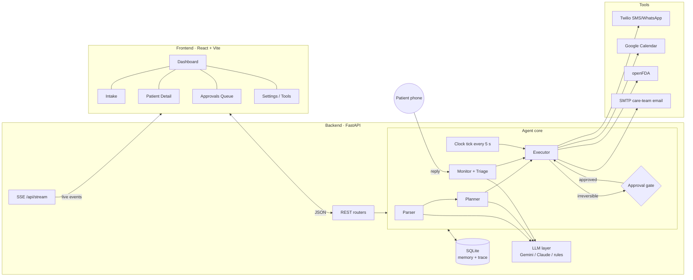

# Ninety-Six — Project Blueprint
**TheAgentX Hackathon · PS-07 Open Track · Final submission: 12 Nov 2026, 10:00 AM**

> An agent that runs the first 96 hours after hospital discharge. It reads the discharge summary, plans the follow-up, books the visit, messages the patient, watches for warning signs, and asks a clinician before doing anything irreversible.

---

## 1. Problem, user, and why it needs an agent

| | |
|---|---|
| **Primary user** | Discharge nurse / care coordinator at a mid-size Indian hospital handling 20–40 discharges a day |
| **Secondary users** | Patient (and caregiver) receiving SMS/WhatsApp check-ins |
| **Job to be done** | Get every discharged patient to their first follow-up safely, with medicines understood and warning signs caught early |
| **Why not a chatbot** | The job takes 96 hours. It involves waiting, scheduled check-ins, reacting to replies, chaining several tools (drug lookup → messaging → calendar → escalation) and re-planning when something changes. A chatbot only answers when asked. This agent keeps working when nobody is watching it. |

### PS-07 must-haves and how we meet them
| Requirement | How Ninety-Six does it |
|---|---|
| Plans its own steps | Planner (LLM, with a rule-based fallback) turns the parsed summary into a timed plan of 8–12 steps across 0–96 h. It re-plans when a reply or a tool result changes things. |
| Real actions via ≥2 tools/APIs | **Twilio** (SMS/WhatsApp sandbox), **Google Calendar** (booking), **openFDA** (drug labels), **SMTP** (care-team alert) |
| Human confirmation before irreversible actions | Every irreversible tool opens an **Approval** card. One "activate schedule" sign-off pre-approves routine templated check-ins. Anything unusual still comes back to the clinician. |
| Who the user is + why an agent | Section 1 above, and slide 1 of the deck |

---

## 2. System architecture



### Agent loop
1. **Parse.** Discharge summary text becomes diagnosis, allergies, medicines, follow-ups, red flags and a risk score. Facts are written to memory.
2. **Plan.** The planner reads memory and the tool catalog, then outputs timed steps (`due_offset_h` from 0 to 96).
3. **Execute.** Each clock tick, due steps run. Safe tools run immediately. Irreversible tools create an Approval and wait.
4. **Gate.** The clinician approves, edits or rejects. Approving runs the step; rejecting is remembered as a preference.
5. **Monitor.** A patient reply is triaged as OK, CONCERN or RED FLAG against that patient's red flags in memory, and the agent re-plans (adds escalation, reply or caregiver steps).
6. **Close.** At 96 h the agent writes a summary for the doctor and marks the episode completed or escalated.

---

## 3. Tech stack

| Layer | Choice | Why |
|---|---|---|
| Backend | Python 3.11+, FastAPI, SQLModel, httpx | Fast to build, async SSE, simple ORM |
| Database / memory | SQLite (`ninety_six.db`) | Zero setup; it is the agent's long-term memory and its trace log |
| LLM | Gemini 2.5 Flash (free tier) or Claude, via plain REST | Swappable with one env var. **Rule-based fallback for every LLM call**, so the demo can't break. |
| Frontend | React 18 + TypeScript + Vite + react-router | Quick dev server, typed API client |
| Live updates | Server-Sent Events | One-way push is enough and simpler than WebSockets |
| Demo time | Simulated clock with a "fast-forward" control | Shows 96 hours in 3 minutes |

---

## 4. Repository structure

```
ninety-six/
├── README.md                     # setup, demo script, screenshots
├── BLUEPRINT.md                  # this file
├── docs/
│   ├── ARCHITECTURE.md           # diagram + agent loop (copy of §2)
│   └── deck-outline.md           # 6-slide deck content
├── scripts/
│   ├── setup.ps1                 # Windows: venv + pip + npm install
│   └── dev.ps1                   # Windows: start backend + frontend
├── backend/
│   ├── requirements.txt
│   ├── .env.example
│   ├── app/
│   │   ├── main.py               # FastAPI app, CORS, routers, lifespan, tick task, serves frontend/dist
│   │   ├── config.py             # env settings; live vs simulated per tool
│   │   ├── clock.py              # SimClock (advance / reset), hours_since, iso()
│   │   ├── db.py                 # engine, init_db, reset_db, get_session
│   │   ├── models.py             # 9 tables (see §5)
│   │   ├── events.py             # EventBus (SSE pub/sub) + log_event() trace helper
│   │   ├── memory.py             # remember(), recall() (logged), facts_as_text()
│   │   ├── serializers.py        # model → JSON dicts for the UI
│   │   ├── seed.py               # 3 fictional sample discharge summaries
│   │   ├── llm/__init__.py       # LLM base, AnthropicLLM, GeminiLLM, get_llm()
│   │   ├── agent/
│   │   │   ├── prompts.py        # PARSER / PLANNER / TRIAGE system prompts
│   │   │   ├── parser.py         # LLM parse + regex fallback + risk heuristic
│   │   │   ├── planner.py        # LLM plan + validation + rule-based plan
│   │   │   ├── executor.py       # run_step, approval gate, run_due_steps, kickoff, replan, decide
│   │   │   └── monitor.py        # triage (LLM + rules safety override), handle_reply, re-planning
│   │   ├── tools/
│   │   │   ├── base.py           # Tool interface: name, irreversible, live(), preview(), run()
│   │   │   ├── messaging.py      # send_message → Twilio
│   │   │   ├── calendar.py       # book_appointment → Google Calendar
│   │   │   ├── drug_info.py      # lookup_drug_info → openFDA + interaction rules
│   │   │   ├── care_team.py      # escalate_to_care_team, activate_schedule, generate_summary
│   │   │   └── __init__.py       # REGISTRY + tool_catalog() for the planner prompt
│   │   └── routers/
│   │       ├── patients.py       # list, detail, discharge intake, replan
│   │       ├── approvals.py      # queue, decide
│   │       ├── simulate.py       # patient reply, clock advance
│   │       ├── system.py         # health, tool status, reset demo, samples
│   │       └── stream.py         # SSE
│   └── tests/
│       └── test_flow.py          # end-to-end: intake → approvals → +24h → red flag → escalation
└── frontend/
    ├── package.json · vite.config.ts (proxy /api → :8000) · tsconfig.json · index.html
    └── src/
        ├── main.tsx · App.tsx (routes + LiveProvider)
        ├── lib/  api.ts · types.ts · live.tsx (SSE hook) · format.ts (12-hour times, T+h)
        ├── pages/  Dashboard · Intake · PatientDetail · Approvals · Settings
        └── components/  (see §8)
```

---

## 5. Data model (SQLite)

| Table | Key fields | Purpose |
|---|---|---|
| **Patient** | name, age, phone, language, caregiver, diagnosis, allergies, risk_level, risk_reasons, status (`planning/active/escalated/completed`), discharge_at, summary_text | One discharge episode |
| **Medication** | patient_id, name, dose, frequency, instructions, warnings | Parsed medicines, with openFDA warnings |
| **Plan** | patient_id, version, goal, rationale, source (`llm/rules`), status (`active/superseded`) | Versioned, so re-plans are visible |
| **Step** | plan_id, seq, title, tool, args (JSON), due_offset_h, group, origin (`plan/replan/followup`), irreversible, preapproved, status, result | The agent's plan, one row per action |
| **Approval** | step_id, title, summary, tool, payload (editable), priority (`normal/urgent`), status, note | Human-in-the-loop queue |
| **Message** | direction (`out/in`), recipient, channel, body, delivery (`live/simulated/failed`), triage | SMS/WhatsApp thread |
| **Appointment** | title, provider, start_at, location, calendar (`google/simulated`), external_id | Booked follow-ups |
| **MemoryFact** | key, value, source (`parser/triage/tool:x/clinician`) | Long-term memory the agent re-reads |
| **Event** | kind (`plan/tool/approval/message/triage/memory/escalation/llm/system`), title, detail | Full agent trace for the UI |

**Step status lifecycle:** `pending → (awaiting_approval → approved | rejected) → running → done | failed`; `skipped` when a plan is superseded.

---

## 6. Tools

| Tool | Real API | Irreversible? | Fallback when no keys |
|---|---|---|---|
| `lookup_drug_info` | openFDA `drug/label.json` (no key) | No | Local warnings table + interaction rules. Finding an interaction **adds a follow-up step** (pharmacist review). |
| `send_message` | Twilio Messages API (SMS or WhatsApp sandbox); `DEMO_PHONE` sends everything to the presenter's phone | **Yes** | Stored as simulated message |
| `book_appointment` | Google Calendar `events.insert` (service account) | **Yes** | Simulated appointment row |
| `escalate_to_care_team` | SMTP email to `CARE_TEAM_EMAIL` | **Yes** | Logged escalation event; patient set to *escalated* |
| `activate_schedule` | internal | **Yes** (clinician sign-off) | Pre-approves the `checkins` group |
| `generate_summary` | internal (+ LLM optional) | No | Template summary saved to memory |

Every tool reports `live()` so the Settings page shows **LIVE / SIMULATED** per integration. That's honest in the demo and it keeps working if an API fails.

---

## 7. Approval-gate design (what counts as irreversible)

- **Always gated:** sending any message, booking any appointment, alerting the care team.
- **Batch sign-off:** at hour 0 the clinician approves "Activate routine check-in schedule". After that, templated check-ins (12 h, 24 h, 48 h, 72 h, closing) and routine "glad you're well" acknowledgements send without asking again.
- **Never covered by the batch:** agent-drafted replies to concerns, caregiver updates, escalations, and safety-net advice. These are individually gated. Red-flag items are marked **URGENT** and sorted to the top.
- **Editable before approval:** the clinician can rewrite a message body on the card, then approve.
- **Rejection is remembered:** rejecting the batch sign-off writes a `clinician_preference` memory fact, and every check-in then asks individually.
- **Safety rule:** in triage, the rules engine can only *escalate* the LLM's verdict, never downgrade it.

---

## 8. Frontend: pages and components

### Pages
| Route | Page | Contents |
|---|---|---|
| `/` | **Dashboard** | Stat cards (active, pending approvals, escalated, completed) · patient table with mini 96-h progress bar, risk badge and next step · live activity feed |
| `/intake` | **New Discharge** | Patient form + paste summary + "Load sample" buttons → starts the agent and opens the patient page |
| `/patients/:id` | **Patient Detail** | Header (name, diagnosis, risk, status) · **96-hour timeline** · Agent plan · Medications · Appointments · Message thread + **Patient simulator** · Memory panel · Activity log · Re-plan button |
| `/approvals` | **Approvals Queue** | Urgent first; each card shows the step, the agent's rationale, a preview, an editable body, and Approve / Reject with a note |
| `/settings` | **Settings & Tools** | LLM provider, per-tool LIVE/SIMULATED status, clock controls, reset demo |

### Components (`src/components/`)
| Component | Role |
|---|---|
| `Sidebar` | Navigation with a live pending-approvals badge |
| `TopBar` + `ClockControl` | Simulated clock in 12-hour format, buttons for +6 h / +24 h fast-forward |
| `StatCards` | Dashboard KPIs |
| `PatientTable` | Patient list with progress, risk and next step |
| `RiskBadge`, `StatusPill` | Colour-coded labels |
| `Timeline96` | Horizontal 0–96 h track: step markers coloured by status, a "now" needle, red markers for flagged replies |
| `PlanView` / `StepRow` | Ordered steps with tool icon, due time, status, rationale, result, and a tag for re-planned steps |
| `ApprovalCard` | Preview, editable payload, approve/reject |
| `MedicationTable` | Medicines with openFDA warnings and interaction alerts |
| `AppointmentList` | Booked visits (Google or simulated) |
| `MessageThread` | Chat-style SMS thread showing delivery and triage tags |
| `PatientSimulator` | Type or click a quick reply ("All good", "Breathless lying flat", "Ran out of tablets") to play the patient in the demo |
| `MemoryPanel` | Memory facts with source, plus a highlight when recently recalled |
| `ActivityLog` | Filterable agent trace (plan / tool / approval / memory / triage) |
| `ToolStatusList` | Integration health for Settings |
| `ui.tsx` | Card, Button, EmptyState, Spinner primitives |

**Live updates:** `LiveProvider` opens one `EventSource('/api/stream')` and increments a version counter on each event. Pages refetch when it changes.

---

## 9. API

| Method | Path | Purpose |
|---|---|---|
| GET | `/api/health` | Liveness |
| GET | `/api/system` | LLM provider, tool status, clock |
| POST | `/api/system/reset` | Wipe DB and reset the clock (start of demo) |
| GET | `/api/samples` | Sample discharge summaries |
| POST | `/api/discharges` | Create patient + start agent (background) |
| GET | `/api/patients` | List with elapsed hours, next step, pending approvals |
| GET | `/api/patients/{id}` | Full detail: meds, plan steps, approvals, messages, appointments, memory, events |
| POST | `/api/patients/{id}/replan` | Force a new plan version |
| GET | `/api/approvals?status=pending` | Queue |
| POST | `/api/approvals/{id}/decide` | `{decision: approve/reject, note, edited_payload}` |
| POST | `/api/simulate/reply` | `{patient_id, text}` as if the patient replied |
| POST | `/api/clock/advance` | `{hours}` then runs due steps |
| GET | `/api/events?patient_id=` | Trace |
| GET | `/api/stream` | SSE |

*(Optional stretch: `POST /api/webhooks/twilio` so real WhatsApp replies come in through the same `handle_reply`.)*

---

## 10. Environment (`backend/.env`)

```
LLM_PROVIDER=gemini            # gemini | anthropic | mock
GEMINI_API_KEY=
ANTHROPIC_API_KEY=
TWILIO_ACCOUNT_SID=
TWILIO_AUTH_TOKEN=
TWILIO_FROM=whatsapp:+14155238886
DEMO_PHONE=+91XXXXXXXXXX       # your phone joined to the Twilio sandbox
GOOGLE_SERVICE_ACCOUNT_FILE=service-account.json
GOOGLE_CALENDAR_ID=            # share the calendar with the service-account email
SMTP_HOST=smtp.gmail.com
SMTP_USER=
SMTP_PASSWORD=                 # Gmail app password
CARE_TEAM_EMAIL=
OPENFDA_ENABLED=true
HOSPITAL_NAME=Sunrise Multispeciality Hospital
EMERGENCY_NUMBER=108
```

### Run on Windows (PowerShell)
```powershell
cd ninety-six\backend
python -m venv .venv
.\.venv\Scripts\Activate.ps1
pip install -r requirements.txt
copy .env.example .env
uvicorn app.main:app --reload --port 8000

# new terminal
cd ninety-six\frontend
npm install
npm run dev        # open http://localhost:5173
```

---

## 11. 3-minute demo script

| Time | Action | Judges see |
|---|---|---|
| 0:00–0:20 | Problem + user (slide) | Why the first 96 hours matter |
| 0:20–0:50 | Intake → load "Heart failure, 68 M" → submit | Parser output, **plan appearing step by step**, memory facts written |
| 0:50–1:20 | Medication review runs → lisinopril + spironolactone interaction → **agent adds a pharmacist step** | Re-planning from a tool result |
| 1:20–1:50 | Approvals: edit and approve the welcome SMS (arrives on the phone), approve the booking (shows in Google Calendar), approve the check-in schedule | Human-in-the-loop, two-plus real tools |
| 1:50–2:20 | Fast-forward +24 h → check-in sends automatically → reply "All good" → auto-acknowledgement | Waiting and monitoring without supervision |
| 2:20–2:50 | Fast-forward +24 h → reply "I get breathless lying flat" → **RED FLAG**, memory recalled, URGENT approval → approve → care-team email | Memory used across steps, safe escalation |
| 2:50–3:00 | Fast-forward to 96 h → summary | End-to-end job done |

---

## 12. Mapping to judging criteria

| Criterion (weight) | Evidence |
|---|---|
| Problem fit & impact (25%) | Readmission in the first week is common and costly; follow-up visits within 7 days help. Named user persona. |
| Agent design (25%) | Visible plan, versioned re-plans, 4 real tools, approval gates, logged memory reads/writes |
| Demo & reliability (20%) | Rule-based fallback for every LLM call, simulated mode per tool, `DEMO_PHONE`, reset button, e2e test |
| Innovation (15%) | Batch sign-off vs per-action gates; rules can only escalate the LLM's triage; 96-hour compressed clock |
| Presentation (15%) | Timeline96 view and live trace tell the story without narration |

---

## 13. Build order (now → 12 Nov 10:00 AM)

| When | Task | Status |
|---|---|---|
| Tue 10 Nov evening | Backend core: config, clock, models, events, memory, LLM layer, 6 tools, parser, planner, executor, monitor, samples | ✅ written |
| Tue 10 Nov night | Routers + `main.py` + serializers + e2e test | ⏳ next |
| Wed 11 Nov morning | Frontend: layout, Dashboard, Intake, Patient Detail, Approvals, Settings | ⏳ |
| Wed 11 Nov afternoon | Connect Twilio sandbox, Google Calendar, Gemini key; test on a real phone | ⏳ |
| Wed 11 Nov evening | README, screenshots, 6-slide deck, record the 3-min video (two takes) | ⏳ |
| Thu 12 Nov by 9:00 AM | Push to GitHub, final check, submit before 10:00 AM | ⏳ |

### Cut list if short on time
1. Drop SMTP (keep escalation simulated) → still 3 real APIs
2. Drop Google Calendar → Twilio + openFDA still meet "≥2 tools"
3. Drop the Twilio webhook (use the in-app Patient simulator)

---

## 14. Safety & ethics notes (for the README and deck)
- Not a diagnostic tool. It never changes medication or gives dosing advice; it routes to clinicians.
- Every outbound action is approved by a clinician, either individually or through a scoped batch sign-off.
- All sample data is fictional. A real deployment needs consent, DPDP Act 2023 compliance and an audit log (the Event table already provides one).
